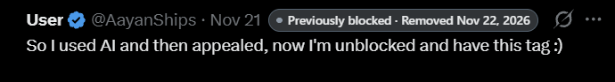

# AI Spam Reporter for X

Report automated spam replies on X through [Blocked for AI Reply](https://blockedforaireply.com/) without manually copying and pasting post links.

[](https://chromewebstore.google.com/detail/ai-spam-reporter-for-x/kopcommfnaleghonicpabffogacdliam)
[](https://github.com/nickash2/ai-spam-reporter-for-x/releases/latest)


## Features

### 1. Report AI spam directly on X

A "Report AI Post" button appears alongside the usual actions on X posts.

<p align="center">
  
</p>

### 2. Review before submitting

The reporting form opens with the post URL & your username already filled in. Review the details before sending your report.

<p align="center">
  
</p>

### 3. Identify blocklisted accounts

Accounts currently listed on Blocked for AI Reply receive a visible badge directly on X.

<p align="center">
  
</p>

### 4. Track previously blocked accounts

Accounts removed from the blocklist receive a separate gray badge showing their removal date. The badge remains visible for 30 days.

<p align="center">
  
</p>

### 5. Customize your experience

The extension popup lets you:

- Enable or disable inline reporting controls.
- Hide posts from currently blocklisted accounts.
- Show or hide previously blocked account badges.
- Check the synchronization status of both lists.
- Manually refresh blocklist data.
- Open the reporting form or copy a post link.

<p align="center">
  
</p>

## Installation

### Chrome Web Store (recommended)

[Install AI Spam Reporter for X](https://chromewebstore.google.com/detail/ai-spam-reporter-for-x/kopcommfnaleghonicpabffogacdliam)

1. Open the Chrome Web Store listing.
2. Click **Add to Chrome**.
3. Confirm the installation.
4. Refresh any X tabs already open.

Chrome automatically handles updates for Web Store installations.

### Manual installation (GitHub)

<details>
<summary>Install or upgrade manually</summary>

1. Open the [latest GitHub release](https://github.com/nickash2/ai-spam-reporter-for-x/releases/latest).
2. Under **Assets**, download `ai-spam-reporter-extension-vX.Y.Z.zip`. Do not use the automatically generated "Source code (zip)" archive.
3. Extract the downloaded ZIP.
4. Open `chrome://extensions` in Chrome.
5. Enable **Developer mode**.
6. Select **Load unpacked** and choose the extracted `extension` folder containing `manifest.json`.
7. Refresh your X tabs.

If you installed an earlier prototype from another folder, disable it to prevent duplicate controls.

</details>

## How it works

### Reporting

Click **Report AI Post** on an X post to open the reporting workflow.

If the service requires human verification, the extension opens a prefilled report form. Review the report and submit it through the website.

You can also:

- Open the reporting form from the extension popup.
- Right-click a post's timestamp and choose **Report AI Post**.
- Copy the post link manually if necessary.

Only report automated spam replies.

### Blocklist matching

The extension downloads the public username list from Blocked for AI Reply and performs exact, case-insensitive matching.

- **Blocked:** The account is currently listed.
- **Previously blocked:** The account was removed from the current list within the last 30 days.

The extension never blocks accounts on your X account.

### Feed hiding

Enable **Hide blocked accounts on X** in the popup to hide feed posts from listed accounts.

Posts opened directly remain visible.

### Synchronization

The extension downloads the public blocklist and removed-account feed on installation and approximately every hour while Chrome is running.

Both lists are synchronized independently. If a refresh fails, the extension preserves the last valid snapshot.

You can also trigger synchronization manually using **Sync lists**.

## Privacy and data handling

AI Spam Reporter for X uses publicly available information from Blocked for AI Reply.

- User preferences and downloaded lists are stored locally.
- X post URLs and account handles are processed for matching and reporting.
- Reports require user action.
- The extension does not automatically block X accounts.
- The extension does not collect analytics, screenshots, account credentials, or reply text.

See [PRIVACY.md](PRIVACY.md) for more information.

## Development

Requirements: Node.js 22 or newer.

Run the automated tests from the project directory:

```sh
node --test
```

The extension also includes safeguards against unexpectedly large decreases in the downloaded blocklist.

## Contributing

Contributions, bug reports, and suggestions are welcome.

- [Report an issue](https://github.com/nickash2/ai-spam-reporter-for-x/issues)
- [View the source code](https://github.com/nickash2/ai-spam-reporter-for-x)
- [Latest releases](https://github.com/nickash2/ai-spam-reporter-for-x/releases/latest)

## Disclaimer

AI Spam Reporter for X is an independent, unofficial extension. It is not affiliated with X or Blocked for AI Reply.

Licensed under the [MIT License](LICENSE).
