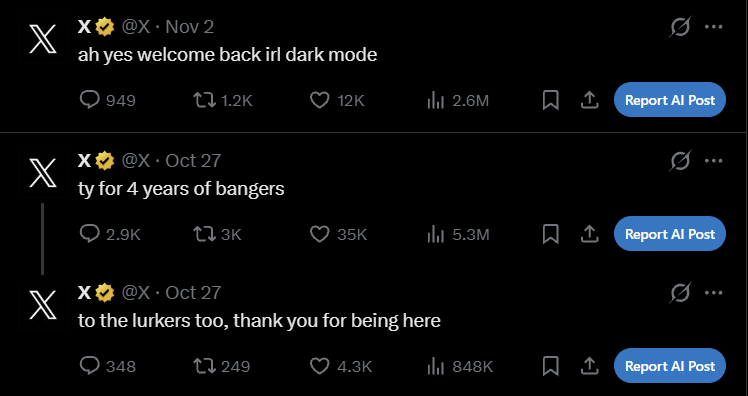
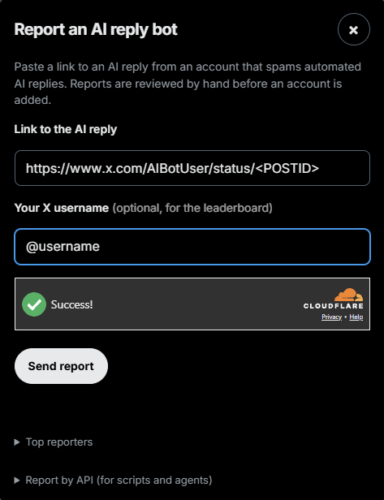
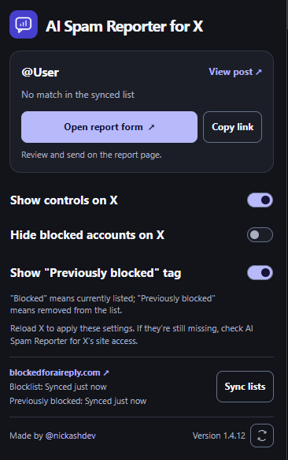

# AI Spam Reporter for X

Report automated spam replies on X to [Blocked for AI Reply](https://blockedforaireply.com/) without copying or pasting the post link.

**[Download the extension ZIP](https://github.com/nickash2/ai-spam-reporter-for-x/releases/latest)**

<table role="presentation">
  <tr>
    <td align="center" valign="top"><strong>1. Click Report AI Post</strong><br></td>
    <td align="center" valign="top"><strong>2. Review and send</strong><br></td>
  </tr>
  <tr>
    <td align="center" valign="top"><strong>Blocklist badge on X</strong><br></td>
    <td align="center" valign="top"><strong>Extension popup</strong><br></td>
  </tr>
  <tr>
    <td align="center" valign="top" colspan="2"><strong>Previously blocked badge on X (visible for 30 days)</strong><br></td>
  </tr>
</table>

## Install or upgrade

1. Under **Assets**, download and extract the ZIP named `ai-spam-reporter-extension-vX.Y.Z.zip`, not **Source code (zip)**.
2. In Chrome, open `chrome://extensions` and enable **Developer mode**.
3. Pick **Load unpacked** and select the extracted `extension` folder containing `manifest.json`.
4. Refresh any X tabs you already had open. If you installed the earlier prototype from a different folder, disable it to avoid two toolbar icons and right-click menu entries.

## Use it

- Click **Report AI Post** alongside Reply and Like. On the report page, review the prefilled link and click **Send report** when ready. Only report automated spam replies.
- Listed accounts display a red badge reading Blocked on **blockedforaireply.com** beside the author in the timeline and below the handle on the opened post. The extension does an exact, case-insensitive match and never modifies your X account.
- If X doesn't display its usual timestamp and author layout, open the post directly and select **Open report form** in the toolbar popup. You can also right-click the post's timestamp and select **Report AI Post**.
- To keep listed accounts out of your feed without blocking each one individually on X, turn on **Hide blocked accounts** in the popup. This hides their feed posts; a post you open directly stays visible.
- Accounts in the site's removed-account feed show a gray **Previously blocked** badge with the removal date for 30 days. **Blocked** means currently listed; **Previously blocked** means removed from the current list. Turn the historical tag off with **Show "Previously blocked" tag**.
- Use the toolbar popup to turn inline controls off, see when each list was last updated, or refresh both lists immediately.

## Data and integration

The service worker downloads the public username feed and the site's removed-account feed on installation and approximately hourly while Chrome is running. The popup shows each feed's last successful sync separately and reports failures independently. It replaces each snapshot on success and preserves the last valid snapshot if a refresh fails.

The post link stays available to the report tab until it closes, so reloading the form can restore it. The report page confirms the link once it fills the field and offers **Copy link** for recovery if the form changes. Only the site's own **Send report** button submits it. The extension does not send reply text, screenshots, account credentials, or analytics.

## Run the checks

From the extracted project directory, use Node.js 22 or newer.

```sh
node --test
```

If a sync fails, AI Spam Reporter for X keeps the last synced list and shows its status in the popup. A drop of more than 25% from a list of at least 100 accounts requires confirmation. **Use smaller list** downloads the list again and accepts it only if it matches the result you reviewed. On narrow pages, the X action displays **Report** and the blocklist badge sits below the author's handle.
