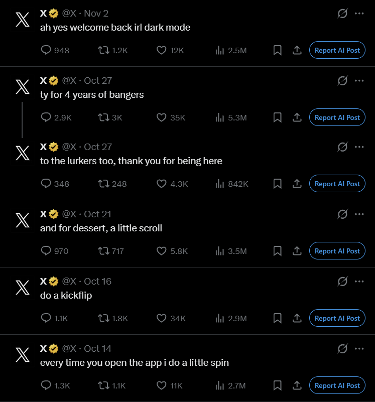

# AI Spam Reporter for X

Report an X post to [Blocked for AI Reply](https://blockedforaireply.levels.io/) without copying or pasting a link. One click on **Report AI Post** in a post’s action row opens the project's own form with the exact post URL filled in. Review the URL and click the site's **Send report** button when ready.

<table>
  <tr>
    <td align="center"><br><sub>Extension popup</sub></td>
    <td align="center"><br><sub>Report from the X feed</sub></td>
  </tr>
  <tr>
    <td align="center"><br><sub>Report form with the post link filled in</sub></td>
    <td align="center"><br><sub>Blocked account badge and post action</sub></td>
  </tr>
</table>

## Install or upgrade

1. Download the extension ZIP from [GitHub Releases](https://github.com/nickash2/ai-spam-reporter-for-x/releases/latest) and extract it.
2. In Chrome, open `chrome://extensions` and enable **Developer mode**.
3. Pick **Load unpacked** and select the extracted `extension` folder containing `manifest.json`.
4. Refresh any X tabs you already had open. If you installed the earlier prototype from a different folder, disable it to avoid two toolbar icons and right-click menu entries.

## Publish a release

1. Update the version in `extension/manifest.json`.
2. Commit and push the change.
3. Create and push a tag matching that version, with a `v` prefix. For example, for version `1.4.3`:

   ```sh
   git tag v1.4.3
   git push origin v1.4.3
   ```

4. GitHub Actions verifies the tag matches the manifest, packages the `extension` folder, and attaches the ZIP to a GitHub Release.

## Use it

- On X, look for **Report AI Post** alongside Reply and Like. Only report posts that are examples of automated spam replies.
- Listed accounts display a red badge reading Blocked on **blockedforaireply.levels.io** beside the author in the timeline and below the handle on the opened post. The extension does an exact, case-insensitive match and never modifies your X account.
- If X doesn't display its usual timestamp and author layout, open the post directly and select **Open report form** in the toolbar popup. You can also right-click the post's timestamp and select **Report AI Post**.
- Use the toolbar popup to turn inline controls off, see when the reviewed list was last updated, or refresh the list immediately.

## Data and integration

The service worker downloads the public username feed on installation and approximately hourly while Chrome is running. It replaces the snapshot on success, including removals, and preserves the last valid snapshot if a refresh fails.

The post link stays available to the report tab until it closes, so reloading the form can restore it. The report page confirms the link once it fills the field and offers **Copy link** for recovery if the form changes. Only the site's own **Send report** button submits it. The extension does not send reply text, screenshots, account credentials, or analytics.

## Run the checks

From the extracted project directory, use Node.js 22 or newer.

```sh
node --test
```

If a sync fails, AI Spam Reporter for X keeps the last synced list and shows its status in the popup. A drop of more than 25% from a list of at least 100 accounts requires confirmation. **Use smaller list** downloads the list again and accepts it only if it matches the result you reviewed. On narrow pages, the X action displays **Report** and the blocklist badge sits below the author's handle.
